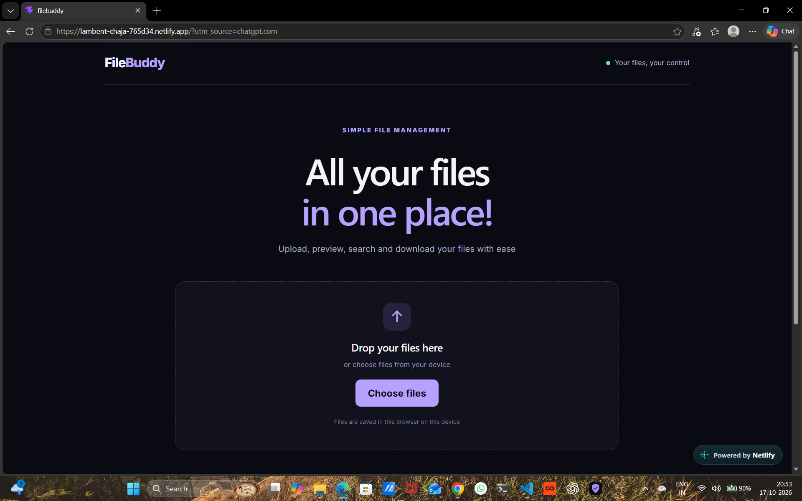

# FileBuddy

A responsive browser based file manager built with React that lets you upload, preview, search, download, and manage files directly in your browser.

## Live Demo

[Visit FileBuddy](https://lambent-chaja-765d34.netlify.app/)

## Preview



## Features

- Drag and drop file uploads
- Preview supported image files
- Download uploaded files
- Remove files
- Search files by name
- Persistent browser storage using IndexedDB
- Responsive design for desktop and mobile
- Clean dark themed interface

## Tech Stack

- React
- JavaScript
- Vite
- HTML5
- CSS
- IndexedDB

## Getting Started

### Prerequisites

Install [Node.js](https://nodejs.org/) before starting.

### Installation

**1. Clone the repository**

```bash
git clone https://github.com/Bharathpurvath/filebuddy.git
```

**2. Enter the project directory**

```bash
cd filebuddy
```

**3. Install dependencies**

```bash
npm install
```

**4. Start the development server**

```bash
npm run dev
```

Open the local URL displayed in your terminal.

## Build for Production

```bash
npm run build
```

The generated production files will be available in the `dist` directory.

## Storage and Privacy

Files are stored locally in your browser using IndexedDB. They are not automatically uploaded to a cloud server or synchronized across devices. Clearing browser site data may remove locally stored files.

## Author

**Bharath B**

[GitHub Profile](https://github.com/Bharathpurvath)

[Project Repository](https://github.com/Bharathpurvath/filebuddy)